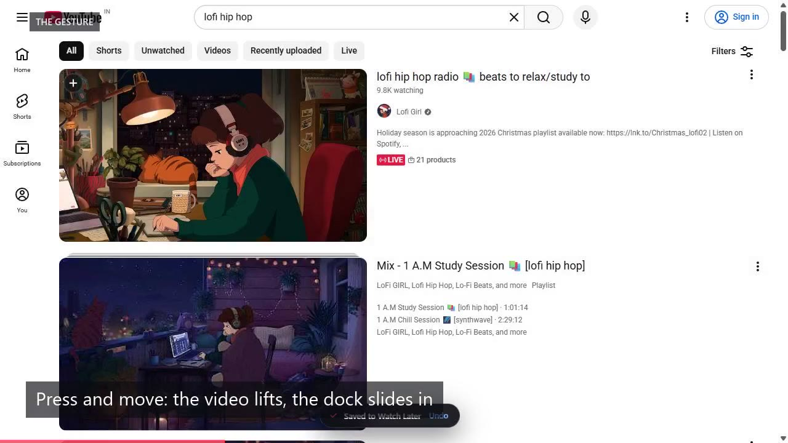
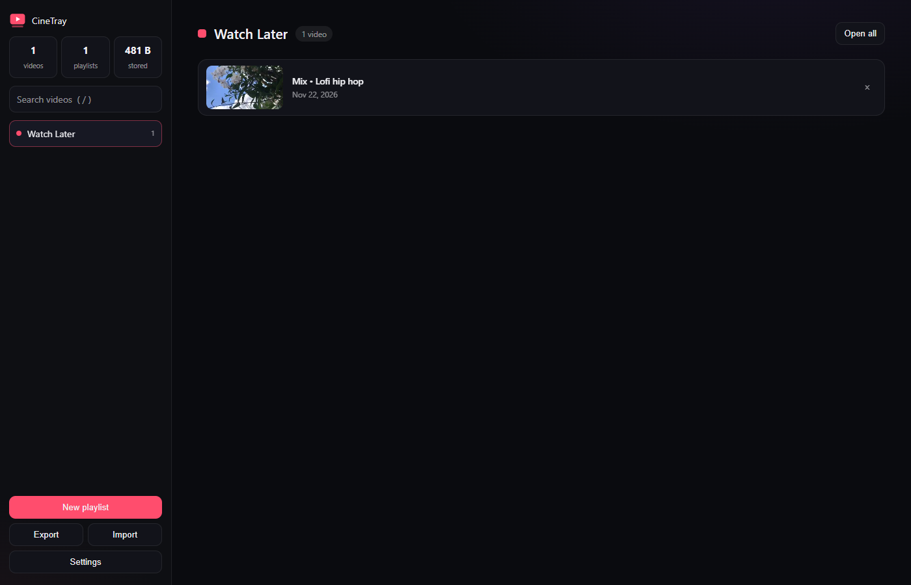

# CineTray


CineTray replaces the "open the three-dot menu, hunt for Save to Watch Later, pick a playlist" routine with a single gesture: press and hold any video on YouTube, and a dock of playlist wells slides in. Drop the card on a well and it is filed — with an undo if you change your mind.

Everything is stored locally in `chrome.storage`. No sign-in, no account access, no network requests of its own.

---

## ▶ Watch the narrated walkthrough

[](docs/walkthrough.mp4)

**[docs/walkthrough.mp4](docs/walkthrough.mp4)** — a 4½-minute voice-over tour of the whole build, recorded live from the real extension. Click the poster above or the link, and GitHub plays it right on the file page; the download button there keeps a copy. This is not a slideshow: the drag-and-drop, the dock sliding in, mid-drag playlist creation, Escape cancel, undo, the dashboard navigation and the settings flips are all captured as they happen.

- **Voice:** a friendly female narrator (synthesized locally with Windows SAPI — no cloud services involved)
- **Captions:** burned into every frame, plus [`docs/walkthrough.vtt`](docs/walkthrough.vtt) for players that support caption files; the full transcript is at the bottom of this page
- **Covers:** installation (performed on camera), the drag gesture, the dock and wells, mid-drag playlist creation, cancel/Escape/undo, the hover chip, right-click saving, player long-press, the dashboard and its settings, popup and badge, and the privacy model

| Chapter | Starts at |
| --- | --- |
| Meet CineTray | 0:00 |
| Why it exists | 0:28 |
| Install in Chrome | 0:49 |
| The gesture | 1:20 |
| The dock | 1:33 |
| Create a playlist mid-drag | 1:51 |
| Cancel and undo | 2:03 |
| The hover chip | 2:18 |
| Right-click saving | 2:34 |
| Player long-press | 2:49 |
| The dashboard | 3:05 |
| Popup and badge | 3:28 |
| Privacy | 3:45 |
| Outro | 4:06 |

The video is generated entirely from this repository — `tools/video/` holds the narration script, the Zira voice-over synthesizer (`speak.ps1`), the CDP frame-capture harness, the slide renderer and the ffmpeg assembly pipeline, so the walkthrough can be rebuilt any time the extension changes. Only the finished video and the pipeline sources are tracked; frames, slides and audio clips are regenerable intermediates.

## The flipbook



An open book that turns its own page through the four chapters of the experience — the gesture, the hover chip, the dashboard, and the feedback layer. Every page hinges at the spine and the chapter list tracks it in sync. It loops; keep watching.

## How it works


**1 — Press and hold.** Rest the cursor on any video card and keep the button down. The card dimples slightly and a soft ripple confirms the grab. (If you prefer to draw, just start moving — the card lifts after a few pixels. On a watch page you can also long-press inside the video player to lift the current video.)

**2 — The card lifts.** A ghost card springs out of the slot with a little overshoot and follows your cursor on a spring, tilting with your movement. The slot it came from is marked with a dashed outline, so you always know where it will return to.

**3 — The dock slides in.** While the card is in the air, a glass dock slides in from the right edge (left edge works too, it's a setting). It holds a well for **Watch Later**, one well per playlist you've created, and a dashed **+ New playlist** well — hovering that one opens an inline field, so you can create a playlist mid-drag and file the card into it without ever letting go of the mouse.

**4 — Drop it in.** Hovering a well makes it inflate and glow; the card leans aside so you can see the target. Release and the card arcs into the well, the well swallows it with a pulse, sparkles fly, and a toast confirms the save. Releasing anywhere else flies the card back to its slot and the dock slides away.

The page behind all of this dims just enough to make the dock read as foreground, and every animation respects both `prefers-reduced-motion` and an in-app animations toggle.

## Install in Chrome



Less than a minute, no build tools required:

1. **Get the folder.** Download this repository (`Code ▸ Download ZIP`, then unzip) or `git clone https://github.com/siddhant-pardeshi/cinetray.git`. Remember where it landed.
2. **Open the extensions page.** Type `chrome://extensions` into Chrome's address bar and press Enter. (Same place via menu: ⋮ ▸ Extensions ▸ Manage Extensions.)
3. **Turn on Developer mode.** The toggle sits in the top-right corner of that page. It only unlocks the "Load unpacked" button — nothing else changes.
4. **Load CineTray.** Click **Load unpacked**, select the downloaded folder (the one containing `manifest.json`), and confirm. A **CineTray** card appears in the list — that's the whole install.
5. **Pin it (optional).** Click the puzzle-piece icon in the toolbar and pin CineTray so the badge is always visible.
6. **Try it.** Open YouTube, rest your cursor on any video, press and drag toward the right edge. The dock is waiting.

**Troubleshooting.** If YouTube was already open when you loaded the extension, refresh the tab once — content scripts join existing pages only on reload. On Edge or Brave the flow is identical (`edge://extensions` / `brave://extensions`). If "Load unpacked" is missing, Developer mode is still off.

## Using CineTray



### The drag

Press any video card and move a few pixels — the card lifts, the dock slides in. Hold without moving for about 0.4 s and the card lifts under a stationary cursor instead, which is the comfortable move on a trackpad. While the card is in the air the page dims slightly and every other pointer interaction is muted, so nothing under you reacts by accident.

### The dock

- **Watch Later** sits at the top with a live count.
- One **well per playlist**, newest activity first, each showing stacked cover art from its latest videos and its own count.
- The dashed **+ New playlist** well: hover it, type a name, press **Enter** — the playlist is created and the card files itself into it, mid-drag, without releasing the mouse.
- Wells inflate and glow as the card approaches; the card leans aside so the target stays visible.

### Cancel, Escape, undo

- Release over nothing: the card flies home, nothing is saved.
- **Escape** cancels a drag from the keyboard.
- Every save toast carries an **Undo** button for a few seconds.
- Dropping the same video twice doesn't duplicate it — the well shakes and the toast says so.

### The other ways in

- **Hover chip:** rest on a card and a small + button appears; one click saves to Watch Later. It floats above YouTube's hover-preview player, so it works even while the preview runs.
- **Right-click:** any video link or thumbnail → CineTray → Watch Later or one of your playlists.
- **Player long-press:** on a watch page, hold inside the player for half a second to lift the current video.
- **Keyboard:** `/` focuses the search field in the dashboard.

### The dashboard

Click the toolbar icon → **Open dashboard**, or the popup's playlist rows for a deep link. Rename playlists by clicking their title, drag rows to reorder, remove videos, hit **Open all** (capped at 12 tabs), search across every playlist with `/`, and export/import the whole collection as JSON. Settings live there too: hover chip, player drag, undo toast, dock side, animations, and a guarded reset.

The dashboard, rendered from the live extension during the automated test run:



## What else is in the box


| Feature | What it does |
| --- | --- |
| Drag-and-drop dock | The flow above — works on the home grid, search results, sidebar, playlist pages and the new `yt-lockup` markup. |
| Hover chip | A small + button appears on a card after a moment of hovering; one click saves to Watch Later. |
| Right-click menu | Right-click any video link or thumbnail → CineTray → Watch Later or one of your playlists. |
| Player long-press | On a watch page, hold inside the player for half a second to lift the current video. |
| Undo toast | Every save toast carries an Undo button for a few seconds. |
| Tray badge | The toolbar icon shows how many videos you've collected in total. |
| Dashboard | A full management page: rename, delete, reorder by dragging, search across every playlist, open-all (max 12 tabs), JSON export/import, settings, and a reset. |
| Duplicate guard | Dropping the same video twice doesn't create a second entry — the well shakes instead. |

## Where your data lives

CineTray has no server and makes no network calls beyond reading YouTube itself. Playlists and settings sit in `chrome.storage.local`, scoped to your browser profile. The toolbar popup and the dashboard both offer JSON export; the dashboard imports it back (merging by playlist name, deduplicating by video id). Reset-everything lives in Settings behind a two-step confirmation.

Storage shape, for reference:

```json
{
  "ct_playlists": [
    {
      "id": "WL",
      "name": "Watch Later",
      "builtin": true,
      "color": "#ff4d6d",
      "videos": [
        {
          "videoId": "jNQXAC9IVRw",
          "title": "Me at the zoo",
          "channel": "jawed",
          "duration": "0:19",
          "thumb": "https://i.ytimg.com/vi/jNQXAC9IVRw/mqdefault.jpg",
          "url": "https://www.youtube.com/watch?v=jNQXAC9IVRw",
          "addedAt": 1763836800000
        }
      ]
    }
  ],
  "ct_settings": { "hoverChip": true, "playerDrag": true, "dockSide": "right", "animations": "full", "toastUndo": true }
}
```

A deliberate note on scope: CineTray keeps its own Watch Later rather than writing into YouTube's server-side one. Writing to the real Watch Later list would require driving YouTube's internal authenticated endpoints, which break on every redesign and are a fragile thing to depend on. Local storage keeps the extension safe, instant, and offline-friendly — and the export file means you own the data regardless.

## Architecture

```
manifest.json          MV3 manifest; permissions limited to storage + contextMenus
background.js          service worker: the single writer for storage, context menus,
                       badge count, and the message router
content/content.js     drag engine: press → lift → travel → drop state machine,
                       ghost card with spring physics, dock and wells, toasts, chip
content/content.css    all injected styling, ct- prefixed, reduced-motion aware
popup/                 compact toolbar popup: playlist list, quick create, two toggles
dashboard/             full management page (rename, reorder, search, import/export,
                       settings, reset)
tools/make_icons.py    regenerates assets/icons/*.png, stdlib-only PNG writer
tools/smoke/           CDP regression suite + diagnostic probe
tools/video/           narration scripts, voice-over clips, frame capture,
                       slide renderer and ffmpeg assembly for walkthrough.mp4
docs/                  the animated SVGs, screenshots, video and captions
```

There is no build step, no bundler, no framework — plain HTML/CSS/JS that a browser can run as-is. All writes go through the service worker so there's exactly one code path mutating storage; readers pull state directly. The drag engine is event-delegated at the document level, which is why it survives YouTube's single-page navigations and markup reshuffles without a MutationObserver running.

## Testing it

`tools/smoke/e2e.cjs` is a ten-scenario regression suite that drives a real headless Chrome over the DevTools Protocol. It loads the unpacked extension, opens a YouTube search, and — with genuine synthesized pointer input — covers: hover-chip save (against YouTube's hover-preview player, which it found and fixed), drag released over nothing (cancel), Escape-to-cancel, drag-and-drop onto Watch Later, creating a playlist mid-drag from the dashed well, the duplicate guard, the context-menu lookup data path, watch-page player long-press with a clean cancel, the dashboard's saved state, and popup stats plus a settings toggle round-trip. Every save assertion is checked against `chrome.storage` through the service worker. `tools/smoke/probe.cjs` is the diagnostic probe used while chasing hit-testing issues.

```bash
chrome --headless=new --remote-debugging-port=9222 \
       --user-data-dir=<fresh dir> \
       --enable-unsafe-extension-debugging about:blank

CDP_PORT=9222 node tools/smoke/e2e.cjs
```

(The `--enable-unsafe-extension-debugging` flag plus CDP `Extensions.loadUnpacked` is how unpacked extensions are loaded on Chrome 137+, where `--load-extension` was removed from branded builds.) Screenshots from the run land in `tools/smoke/out/`; the ones embedded above came from exactly that pipeline.

Last full run: all ten scenarios green, ending with `popup stats count all saved videos: "3 videos · 2 playlists"`.

## Rebuilding the walkthrough video

`tools/video/` is a self-contained pipeline: `script/*.txt` holds the narration, `speak.ps1` synthesizes it with Microsoft Zira, `record.cjs` performs the interactions on the real extension over CDP and photographs every moment (polling `captureScreenshot` — headless screencast proved unusable, pushing only 3 frames per section), `build_slides.cjs` composes the designed cards, and `assemble.cjs` cuts motion segments and slides together (Ken Burns drift, dip-to-black fades, burned-in captions, padded narration) into `docs/walkthrough.mp4`. `make_vtt.cjs` regenerates the caption file from the exact segment starts. Each stage writes plain files you can inspect and re-run.

## Compatibility notes

- Built for Manifest V3, minimum Chrome 111 (the dock and dashboard use `color-mix()`).
- The hover chip is portaled to the document root and pinned over the hovered card, because YouTube's hover-preview player mounts a floating element that outranks anything left inside the card's subtree.
- YouTube ships several generations of card markup (`ytd-rich-grid-media`, `ytd-video-renderer`, `yt-lockup-view-model`) and several link shapes (`watch?v=`, `youtu.be`, `/shorts/`, `/live/`); the selectors cover all of them and fall back to heading/aria-label text when class names drift again.
- The extension never touches YouTube's own buttons or network calls — if it were ever uninstalled, YouTube is exactly as it was and the export file still has your playlists.

## Ideas on the board

- Shared-color themes per playlist (colors are currently cycled from a palette)
- A "queue shuffle" action on the dashboard
- Optional keyboard-only filing mode

## Full walkthrough transcript

<details>
<summary>Every word of the narration, with chapter timestamps</summary>

**[0:00] Meet CineTray** — Hi there, and welcome to CineTray! CineTray is a tiny Chrome extension that turns saving YouTube videos into a single, delightful gesture. Instead of opening menus and hunting for buttons, you simply press a video, drag it onto a dock, and drop it into Watch Later or any playlist you like. Let me walk you through everything, step by step.

**[0:28] Why it exists** — Saving a video the normal way takes three clicks: open the three-dot menu, choose Save to Watch Later, then pick a playlist. And there is nothing visual about it. CineTray replaces all of that with one smooth drag-and-drop motion, and it makes your collection feel alive while you build it.

**[0:49] Install in Chrome** — Installing CineTray takes less than a minute. First, download or clone the project folder from GitHub. Second, open Chrome and type chrome dash extensions into the address bar. Third, switch on Developer mode in the top right corner. Fourth, click Load unpacked, and select the folder you downloaded. That is it! CineTray now lives in your toolbar. Open YouTube, and you are ready to go.

**[1:20] The gesture** — Now for the fun part. Hover any video on YouTube, on the home page, in search results, anywhere. Press and hold, and move your mouse just a little. The video lifts out of its slot as a floating card that follows your cursor, and a glass dock slides in from the right side of the screen.

**[1:33] The dock** — The dock is your filing cabinet. Glide across it with me: Watch Later with a live count, then a well for every playlist, each one glowing as the card comes close. And the dashed well at the bottom is where new playlists are born.

**[1:51] Create a playlist mid-drag** — You can even create a playlist without letting go: hover the dashed well, type a name, press Enter, and the card files itself straight in.

**[2:03] Cancel and undo** — Changed your mind? Escape flies the card home, nothing saved. And watch this: drop one in, press Undo, and it hops right back out of the list.

**[2:18] The hover chip** — Prefer one click saving? Rest your cursor on a video card, and a small plus button appears in the corner. One click saves the video straight to Watch Later, complete with sparkles.

**[2:34] Right-click saving** — You can also right click any video link or thumbnail, and choose CineTray from the menu. Save it to Watch Later, or straight into one of your playlists, without even hovering the card first.

**[2:49] Player long-press** — On a watch page, you do not even need the list around. Press and hold inside the video player for half a second, and the current video lifts up, ready to drop into any well in the dock.

**[3:37] The dashboard** — The dashboard is mission control. Click the CineTray icon and choose Open dashboard. On the left you will find every playlist with its own color and count. Pick one to browse its videos, rename it, drag rows to reorder them, or remove anything you do not want. Open All launches up to twelve videos at once. You can search across every playlist from the box on the left, and export or import your whole collection as a single JSON file. Settings let you fine tune the hover chip, player dragging, the undo button, which side the dock slides from, and the animations.

**[3:28] Popup and badge** — The popup is the quick glance: total saves, and every playlist. Watch me type a new playlist name right here, and it appears instantly. The toolbar badge counts the whole collection.

**[3:45] Privacy** — One important thing. CineTray is completely local. Your playlists live inside your own browser. No accounts, no sign in, and the extension never talks to any server. Export your collection any time. The file is yours.

**[4:06] Outro** — And that is CineTray! Press, drag, drop, and enjoy your beautifully organized video shelf. The full project, with this walkthrough video and the complete documentation, is on GitHub. Happy collecting!

</details>

## License

MIT — see [LICENSE](LICENSE).
