# CineTray



CineTray replaces the "open the three-dot menu, hunt for Save to Watch Later, pick a playlist" routine with a single gesture: press and hold any video on YouTube, and a dock of playlist wells slides in. Drop the card on a well and it is filed — with an undo if you change your mind.

Everything is stored locally in `chrome.storage`. No sign-in, no account access, no network requests of its own.

---

## How it works



**1 — Press and hold.** Rest the cursor on any video card and keep the button down. The card dimples slightly and a soft ripple confirms the grab. (If you prefer to draw, just start moving — the card lifts after a few pixels. On a watch page you can also long-press inside the video player to lift the current video.)

**2 — The card lifts.** A ghost card springs out of the slot with a little overshoot and follows your cursor on a spring, tilting with your movement. The slot it came from is marked with a dashed outline, so you always know where it will return to.

**3 — The dock slides in.** While the card is in the air, a glass dock slides in from the right edge (left edge works too, it's a setting). It holds a well for **Watch Later**, one well per playlist you've created, and a dashed **+ New playlist** well — hovering that one opens an inline field, so you can create a playlist mid-drag and file the card into it without ever letting go of the mouse.

**4 — Drop it in.** Hovering a well makes it inflate and glow; the card leans aside so you can see the target. Release and the card arcs into the well, the well swallows it with a pulse, sparkles fly, and a toast confirms the save. Releasing anywhere else flies the card back to its slot and the dock slides away.

The page behind all of this dims just enough to make the dock read as foreground, and every animation respects both `prefers-reduced-motion` and an in-app animations toggle.

## What else is in the box



| Feature | What it does |
| --- | --- |
| Drag-and-drop dock | The flow above — works on the home grid, search results, sidebar, playlist pages and the new `yt-lockup` markup. |
| Hover chip | A small + button appears on a card after a moment of hovering; one click saves to Watch Later. |
| Right-click menu | Right-click any video link or thumbnail → CineTray → Watch Later or one of your playlists. |
| Player long-press | On a watch page, hold inside the player for half a second to lift the current video. |
| Undo toast | Every save toast carries an Undo button for a few seconds. |
| Tray badge | The toolbar icon shows how many videos you've collected in total. |
| Dashboard | A full management page: rename, delete, reorder by dragging, search across every playlist, open-all (max 12 tabs), JSON export/import, settings, and a reset. |
| Duplicate guard | Dropping the same video twice doesn't create a second entry — the well shakes instead. |

The dashboard, rendered from the live extension during the automated test run:


## Install

1. Download or clone this repository.
2. Open `chrome://extensions`.
3. Turn on **Developer mode** (top right).
4. Click **Load unpacked** and select the repository folder (the one containing `manifest.json`).
5. Open YouTube. That's it.

Only Chromium-based browsers are supported (Chrome, Edge, Brave — anything that speaks Manifest V3). Firefox uses a different extension format and is not covered.

## Using it

- **Drag:** press a card, move a few pixels — the dock appears.
- **Hold:** press and don't move for ~0.4 s — the card lifts under a stationary cursor, handy on trackpads.
- **New playlist mid-drag:** hover the dashed well, type a name, press Enter. The playlist is created and the card files itself.
- **Escape hatch:** release over nothing and the card flies home; nothing is saved. **Escape** cancels a drag from the keyboard too.
- **Keyboard:** `/` focuses the search field in the dashboard.
- **Settings:** toolbar icon → Open dashboard → Settings. Toggles for the hover chip, player long-press, undo button, dock side (left/right) and animations (full/off).

## Where your data lives

CineTray has no server and makes no network calls beyond reading YouTube itself. Playlists and settings sit in `chrome.storage.local`, scoped to your browser profile. The toolbar popup and the dashboard both offer JSON export; the dashboard imports it back (merging by playlist name, deduplicating by video id). Reset-everything lives in Settings behind a two-step confirmation.

Storage shape, for reference:

```json
{
  "ct_playlists": [
    {
      "id": "WL",
      "name": "Watch Later",
      "builtin": true,
      "color": "#ff4d6d",
      "videos": [
        {
          "videoId": "jNQXAC9IVRw",
          "title": "Me at the zoo",
          "channel": "jawed",
          "duration": "0:19",
          "thumb": "https://i.ytimg.com/vi/jNQXAC9IVRw/mqdefault.jpg",
          "url": "https://www.youtube.com/watch?v=jNQXAC9IVRw",
          "addedAt": 1763836800000
        }
      ]
    }
  ],
  "ct_settings": { "hoverChip": true, "playerDrag": true, "dockSide": "right", "animations": "full", "toastUndo": true }
}
```

A deliberate note on scope: CineTray keeps its own Watch Later rather than writing into YouTube's server-side one. Writing to the real Watch Later list would require driving YouTube's internal authenticated endpoints, which break on every redesign and are a fragile thing to depend on. Local storage keeps the extension safe, instant, and offline-friendly — and the export file means you own the data regardless.

## Architecture

```
manifest.json          MV3 manifest; permissions limited to storage + contextMenus
background.js          service worker: the single writer for storage, context menus,
                       badge count, and the message router
content/content.js     drag engine: press → lift → travel → drop state machine,
                       ghost card with spring physics, dock and wells, toasts, chip
content/content.css    all injected styling, ct- prefixed, reduced-motion aware
popup/                 compact toolbar popup: playlist list, quick create, two toggles
dashboard/             full management page (rename, reorder, search, import/export,
                       settings, reset)
tools/make_icons.py    regenerates assets/icons/*.png, stdlib-only PNG writer
tools/smoke/e2e.cjs    ten-scenario CDP regression suite (see below)
tools/smoke/probe.cjs  diagnostic probe for hit-testing and chip behavior
docs/                  the animated SVGs and screenshots used in this README
```

There is no build step, no bundler, no framework — plain HTML/CSS/JS that a browser can run as-is. All writes go through the service worker so there's exactly one code path mutating storage; readers pull state directly. The drag engine is event-delegated at the document level, which is why it survives YouTube's single-page navigations and markup reshuffles without a MutationObserver running.

## Testing it

`tools/smoke/e2e.cjs` is a ten-scenario regression suite that drives a real headless Chrome over the DevTools Protocol. It loads the unpacked extension, opens a YouTube search, and — with genuine synthesized pointer input — covers: hover-chip save (against YouTube's hover-preview player, which it found and fixed), drag released over nothing (cancel), Escape-to-cancel, drag-and-drop onto Watch Later, creating a playlist mid-drag from the dashed well, the duplicate guard, the context-menu lookup data path, watch-page player long-press with a clean cancel, the dashboard's saved state, and popup stats plus a settings toggle round-trip. Every save assertion is checked against `chrome.storage` through the service worker. `tools/smoke/probe.cjs` is the diagnostic probe used while chasing hit-testing issues.

```bash
chrome --headless=new --remote-debugging-port=9222 \
       --user-data-dir=<fresh dir> \
       --enable-unsafe-extension-debugging about:blank

CDP_PORT=9222 node tools/smoke/e2e.cjs
```

(The `--enable-unsafe-extension-debugging` flag plus CDP `Extensions.loadUnpacked` is how unpacked extensions are loaded on Chrome 137+, where `--load-extension` was removed from branded builds.) Screenshots from the run land in `tools/smoke/out/`; the ones embedded above came from exactly that pipeline.

Last full run: all ten scenarios green, ending with `popup stats count all saved videos: "3 videos · 2 playlists"`.

## Compatibility notes

- Built for Manifest V3, minimum Chrome 111 (the dock and dashboard use `color-mix()`).
- The hover chip is portaled to the document root and pinned over the hovered card, because YouTube's hover-preview player mounts a floating element that outranks anything left inside the card's subtree.
- YouTube ships several generations of card markup (`ytd-rich-grid-media`, `ytd-video-renderer`, `yt-lockup-view-model`) and several link shapes (`watch?v=`, `youtu.be`, `/shorts/`, `/live/`); the selectors cover all of them and fall back to heading/aria-label text when class names drift again.
- The extension never touches YouTube's own buttons or network calls — if it were ever uninstalled, YouTube is exactly as it was and the export file still has your playlists.

## Ideas on the board

- Shared-color themes per playlist (colors are currently cycled from a palette)
- A "queue shuffle" action on the dashboard
- Optional keyboard-only filing mode

## License

MIT — see [LICENSE](LICENSE).
